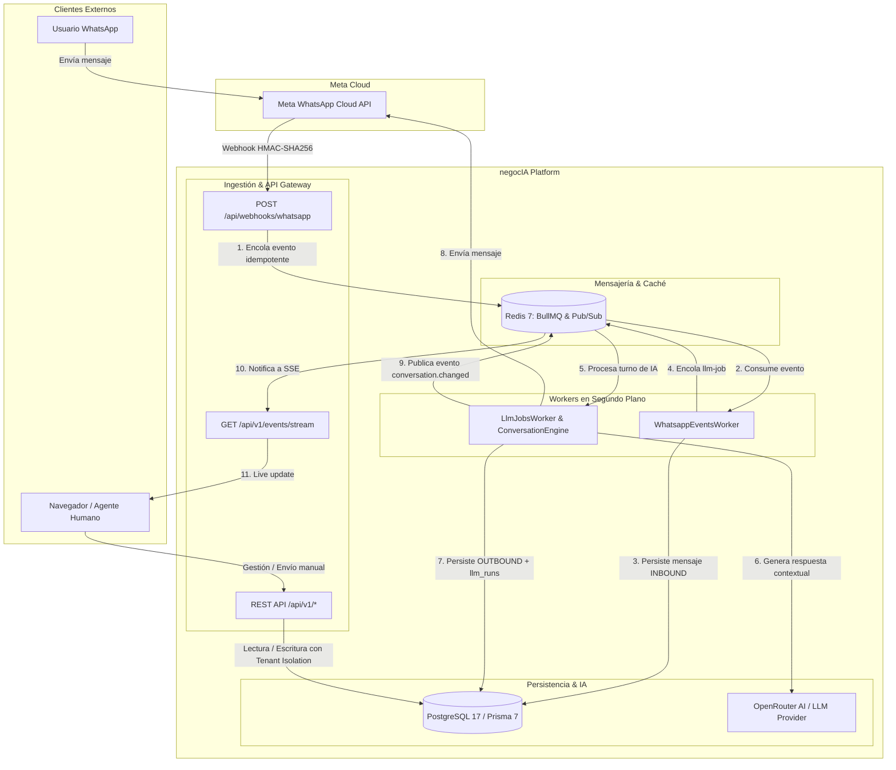

# negocIA

> **SaaS B2B multi-tenant que automatiza la atención comercial, ventas y agendamiento por WhatsApp mediante asistentes de IA contextuales para PyMEs de Chile y LATAM.**

---

[](https://nodejs.org/)
[](https://pnpm.io/)
[](https://www.typescriptlang.org/)
[](https://nestjs.com/)
[-000000?style=flat-square&logo=next.js&logoColor=white)](https://nextjs.org/)
[](https://www.postgresql.org/)
[](https://redis.io/)
[](https://bullmq.io/)
[](https://www.prisma.io/)
[](https://github.com/CodeMonkReaper/negocIA/actions)
[](#arquitectura-y-decisiones-técnicas)
[](#)

---

## El Problema vs. La Solución

### El Problema
Las micro, pequeñas y medianas empresas en Latinoamérica canalizan la gran mayoría de su adquisición y retención de clientes por WhatsApp. Sin embargo, enfrentan fricciones críticas:
- **Pérdida de conversiones:** Hasta un 60% de los prospectos abandonan el proceso si no reciben respuesta inmediata o cuando escriben fuera de horario laboral.
- **Sobrecarga operativa manual:** Los agentes humanos gastan horas contestando preguntas frecuentes, verificando disponibilidad de agenda y tomando pedidos de forma manual en chats dispersos.
- **Falta de visibilidad y control centralizado:** Múltiples números personales de empleados provocan fuga de prospectos, falta de trazabilidad en las conversaciones y nula integración con los procesos de negocio.

### La Solución
**negocIA** provee una plataforma SaaS B2B integral y multi-tenant que conecta las líneas de WhatsApp Business oficiales (Meta Cloud API) con un agente de Inteligencia Artificial contextual capaz de:
- Atender 24/7 con respuestas inmediatas, tono de marca y contexto del cliente.
- Ejecutar flujos de venta y agendamiento de citas sin intervención humana innecesaria.
- Sincronizar en tiempo real las conversaciones con un panel de control web unificado, permitiendo la intervención manual de agentes humanos cuando sea requerido.
- Garantizar estricto aislamiento de datos, seguridad criptográfica y alta disponibilidad técnica para cada empresa cliente.

---

## Arquitectura y Decisiones Técnicas

El repositorio está estructurado como un **Monorepo gestionado con Turborepo y pnpm**, implementando un backend tipo **Modular Monolith** guiado por principios de Clean Architecture y Domain-Driven Design (DDD).

```text
negocIA/
├── apps/
│   ├── api/                 # Backend NestJS (Modular Monolith) + Workers BullMQ asíncronos
│   └── web/                 # Frontend Next.js 16 (App Router) + Tailwind CSS v4 + SSE Client
├── packages/
│   ├── contracts/           # DTOs, tipos de wire y esquemas de error compartidos
│   ├── config/              # Validación estricta de entorno + CryptoService (AES-256-GCM)
│   ├── database/            # Prisma 7 (@prisma/adapter-pg), esquemas y migraciones SQL
│   └── eslint-config/       # Configuración compartida de ESLint flat
└── infra/
    └── docker/              # Docker Compose para PostgreSQL 17 y Redis 7 con healthchecks
```

### Decisiones Técnicas Clave
1. **Modular Monolith con Separación de Procesos:** La API y los Workers de procesamiento en segundo plano comparten el mismo dominio y modelos en `apps/api`, pero se ejecutan en procesos independientes (`start` vs. `start:worker`). Esto evita la complejidad operativa de microservicios prematuros mientras aísla la carga del LLM y de los webhooks.
2. **Aislamiento Multi-Tenant Estricto:** Toda entidad en la base de datos se encuentra particionada por `tenant_id`. La capa de presentación y dominio valida la pertenencia del recurso antes de cualquier operación; solicitudes hacia recursos ajenos devuelven `404 Not Found` en lugar de `403 Forbidden` para prevenir ataques de enumeración.
3. **Ingestión Asíncrona & Idempotente de Webhooks:** El webhook de Meta WhatsApp se valida de forma síncrona mediante HMAC-SHA256 (`X-Hub-Signature-256`) y retorna `HTTP 200` en <100ms para cumplir con el SLA de Meta. El procesamiento se delega a BullMQ/Redis con deduplicación por clave única `provider_event_id`.
4. **Cifrado de Secretos At-Rest (AES-256-GCM):** Los tokens de acceso de Meta Cloud API (`access_token`) obtenidos vía OAuth/Embedded Signup se almacenan cifrados con clave de 256 bits mediante `CryptoService`.
5. **Tiempo Real Unidireccional con SSE + Redis Pub/Sub:** En lugar de mantener costosas conexiones bidireccionales WebSocket, el panel web se conecta a un stream de Server-Sent Events (SSE) autenticado con Bearer tokens. Los workers publican eventos en Redis Pub/Sub y la API los retransmite a los clientes suscritos.
6. **Proveedor de IA Desacoplado (Puerto `LlmProvider`):** La lógica de negocio no interactúa con SDKs propietarios. Se utiliza un adaptador sobre OpenRouter, permitiendo intercambiar modelos (ej. Llama 3, Claude, GPT-4o-mini) mediante variables de configuración sin tocar código.

### Diagrama de Arquitectura y Flujo de Eventos



---

## Características Clave (Features)

### Seguridad, Identidad & Multi-Tenancy
- **Autenticación Robusta:** JWT HS256 de corta duración (15 min) + Refresh Tokens rotativos con detección automática de reuso y revocación en cascada.
- **Hashing Criptográfico OWASP:** Contraseñas protegidas con `argon2id` configurado bajo parámetros de alta memoria y resistencia contra ataques de canal lateral.
- **Control de Acceso Basado en Roles (RBAC):** Jerarquía de roles estricta (`OWNER` > `ADMIN` > `AGENT`) con protección de invariantes (imposibilidad de dejar a un tenant sin su último `OWNER`).
- **Onboarding Seguro:** Invitaciones de equipo con tokens hasheados de un solo uso por correo y verificación de email.

### Canal WhatsApp Oficial & Meta Cloud API
- **Webhook Idempotente:** Handshake de verificación (`hub.verify_token`) y validación de firma criptográfica `X-Hub-Signature-256`.
- **Meta Embedded Signup:** Flujo OAuth simplificado para conectar cuentas de WhatsApp Business de clientes con intercambio de credenciales y almacenamiento cifrado en reposo.
- **Trazabilidad Completa de Estados:** Registro de transiciones de mensajes (`SENT`, `DELIVERED`, `READ`, `FAILED`) y deduplicación por `provider_message_id`.

### Motor de Conversación & Asistente de IA
- **Memoria Contextual:** Carga dinámica del historial conversacional (últimos 50 mensajes) para contextualizar el prompt del sistema.
- **Auditoría de Inferencia (`llm_runs`):** Registro detallado de tokens consumidos, costo, modelo real utilizado y latencia de respuesta para cada interacción.
- **Control de Intervención:** Máquina de estados conversacionales (`BOT_ACTIVE`, `HUMAN_REQUESTED`, `HUMAN_ACTIVE`, `CLOSED`) lista para handoff a agentes humanos.

### Panel Web en Tiempo Real (Next.js)
- **Inbox Unificado:** Bandeja de conversaciones paginada con filtrado por estado y visualización en tiempo real.
- **Chat Interactivo:** Envío de mensajes manuales por agentes humanos con retroalimentación instantánea.
- **Live Updates:** Actualizaciones en vivo vía Server-Sent Events (SSE) con degradación elegante a polling periódico en caso de corte de red.

---

## Guía Rápida de Instalación y Ejecución Local

### Prerrequisitos
- **Node.js:** Versión 24 LTS o superior.
- **pnpm:** Versión 12 o superior (`corepack enable` o `npm install -g pnpm@12.6.0`).
- **Docker & Docker Compose:** Para ejecutar los servicios de base de datos y colas.

### 1. Clonar el repositorio e instalar dependencias
```bash
git clone https://github.com/CodeMonkReaper/negocIA.git
cd negocIA
pnpm install
```

### 2. Configurar variables de entorno
Copia la plantilla de entorno preconfigurada para desarrollo:
```bash
cp .env.example .env
```
> El archivo `.env.example` contiene valores seguros por defecto para ejecutar con adaptadores `mock` (sin necesidad de credenciales reales de Meta ni OpenRouter).

### 3. Levantar la infraestructura local
Inicia los contenedores de PostgreSQL 17 y Redis 7:
```bash
pnpm db:up
pnpm db:ps       # Verifica que ambos contenedores reporten estado healthy
```

### 4. Preparar la Base de Datos y Compilar
Aplica las migraciones pendientes y genera los clientes de tipos:
```bash
pnpm prisma:deploy
pnpm build
```

### 5. Iniciar la plataforma en modo desarrollo
Abre dos terminales para ejecutar los servicios en paralelo:

**Terminal 1 — API NestJS & Panel Web:**
```bash
pnpm dev
# API disponible en: http://localhost:4000/api
# Web disponible en: http://localhost:3000
```

**Terminal 2 — Worker BullMQ (Eventos y Motor LLM):**
```bash
pnpm --filter @negocia/api start:worker
```

*(Opcional)* Si deseas integrar con Meta WhatsApp real mediante un túnel público:
```bash
ngrok http 4000
# Actualiza META_EMBEDDED_SIGNUP_REDIRECT_URI en tu .env con la URL de ngrok
```

### Comandos de Operación Frecuentes

| Comando | Descripción |
|---|---|
| `pnpm dev` | Inicia API (`:4000`) y Frontend (`:3000`) en modo observador (watch) |
| `pnpm --filter @negocia/api start:worker` | Inicia el worker de colas BullMQ (`whatsapp-events`, `llm-jobs`) |
| `pnpm build` | Compila todos los paquetes y aplicaciones mediante Turborepo |
| `pnpm verify` | Ejecuta el pipeline completo de calidad: lint + typecheck + unit + integration + e2e + db:check |
| `pnpm test` | Ejecuta tests unitarios con Vitest |
| `pnpm test:integration` | Ejecuta tests de integración con base de datos PostgreSQL real |
| `pnpm test:e2e` | Ejecuta tests de extremo a extremo (E2E) con Supertest |
| `pnpm prisma:studio` | Abre la interfaz visual de administración de base de datos Prisma Studio |
| `pnpm db:down` | Detiene los contenedores Docker preservando los volúmenes de datos |

---

## Endpoints y Documentación (Demo)

### Enlaces de Servicio Local
- **Panel Web Frontend:** [http://localhost:3000](http://localhost:3000)
- **Documentación OpenAPI / Swagger UI:** [http://localhost:4000/api/docs](http://localhost:4000/api/docs)
- **Especificación Swagger JSON:** [http://localhost:4000/api/docs-json](http://localhost:4000/api/docs-json)
- **Sondeo de Liveness:** `GET http://localhost:4000/api/health`
- **Sondeo de Readiness (DB + Redis):** `GET http://localhost:4000/api/health/ready`

### Catálogo de Rutas Principales de la API (`/api/v1`)

| Módulo | Método | Endpoint | Acceso | Descripción |
|---|---|---|---|---|
| **Auth** | `POST` | `/api/v1/auth/register` | Público | Registro de usuario + creación de tenant con membresía OWNER |
| | `POST` | `/api/v1/auth/login` | Público | Autenticación de credenciales y emisión de tokens |
| | `POST` | `/api/v1/auth/refresh` | Público | Rotación segura de refresh token |
| | `GET` | `/api/v1/auth/me` | Bearer | Perfil y membresías activas del usuario |
| | `POST` | `/api/v1/auth/switch-tenant` | Bearer | Cambio de tenant activo de trabajo |
| **Invitaciones** | `POST` | `/api/v1/invitations` | OWNER / ADMIN | Emisión de invitación a nuevo colaborador por email |
| | `POST` | `/api/v1/invitations/accept` | Público | Aceptación de invitación y activación de cuenta |
| **Tenants** | `GET` | `/api/v1/tenants/current` | Miembro | Información y configuración del tenant activo |
| | `GET` | `/api/v1/tenants/:id/users` | Miembro | Lista de miembros y roles del equipo |
| **WhatsApp** | `GET/POST` | `/api/webhooks/whatsapp` | Meta / Firma | Handshake y recepción de eventos de WhatsApp |
| | `GET` | `/api/v1/whatsapp/accounts` | Miembro | Listado de números y cuentas conectadas al tenant |
| | `GET` | `/api/v1/whatsapp/accounts/embedded-signup/url` | OWNER | Genera URL firmada de OAuth Embedded Signup |
| **Conversaciones**| `GET` | `/api/v1/conversations` | AGENT+ | Bandeja paginada de chats del tenant |
| | `GET` | `/api/v1/conversations/:id/messages` | AGENT+ | Historial de mensajes de una conversación |
| | `POST` | `/api/v1/conversations/:id/messages` | AGENT+ | Envío manual de mensaje outbound a Meta Cloud API |
| | `GET` | `/api/v1/conversations/:id/runs` | AGENT+ | Historial de ejecuciones y trazas del motor de IA |
| **Realtime** | `GET` | `/api/v1/events/stream` | Bearer | Stream SSE para actualizaciones en vivo del panel |

---

## Licencia

Propiedad de **negocIA**. Todos los derechos reservados.